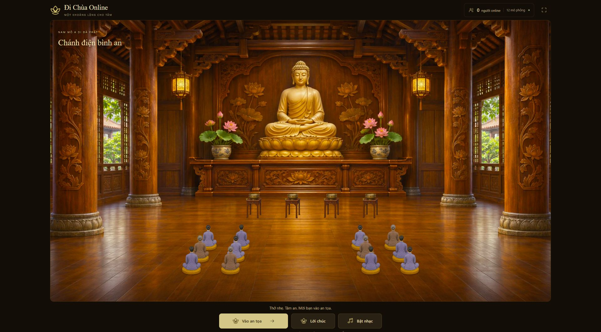
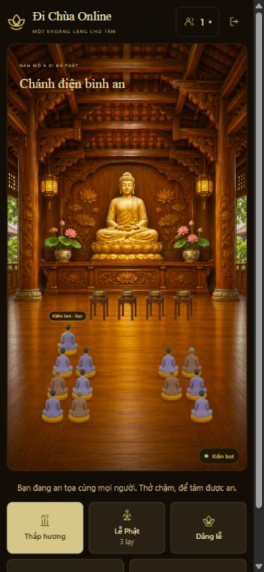

# Nhân vật mô phỏng an tọa

Phiên bản tiếp theo bổ sung [tên và số lượng ngẫu nhiên theo lượt mở trang](../ambient-devotees-v2/README.md).

Bản cập nhật ngày 05/11/2026 bổ sung nhân vật ngồi để phòng ít khách vẫn có
cảm giác có người cùng hiện diện. Các nhân vật chỉ ngồi nhìn lên Phật, không
đi lại, làm lễ, phát âm thanh, nhận thao tác hay hiển thị tên giả.

- Phòng chưa có khách: 12 nhân vật, chia ba hàng ở hai bên lối giữa.
- Nam áo lam, nữ áo lam và áo nâu dùng lại đúng hình ngồi quay lưng hiện có.
- Mỗi người thật vào sẽ giảm số nhân vật mô phỏng, duy trì tối thiểu khoảng
  12 người/nhân vật hiện diện. Khi có từ 12 khách thật, không cần thêm bot.
- Ghế của khách thật luôn được giữ, kể cả khi khách đang tiến lên làm lễ.
- Vị trí và y phục dựa trên số ghế, không xáo trộn theo thời gian hay thứ tự snapshot.
- Bộ đếm và danh sách khách chỉ tính thành viên thật. Số nhân vật mô phỏng được
  ghi riêng; trên điện thoại xem giải thích trong danh sách khách.

Đây là lớp hình ảnh ở frontend, không tạo tài khoản, token, heartbeat hay thành
viên server. Sức chứa 24 khách thật được giữ nguyên. Bộ ảnh ngồi đã nằm trong
nhóm tài nguyên bắt buộc; không tải thêm bộ chuyển động cho bot hoặc chạy thêm
vòng hoạt ảnh.

## Kiểm tra

- Typecheck và build production đạt; 131/131 bài kiểm tra đạt.
- Kiểm ghế rải rác với mọi số khách từ 0 đến 24: không trùng ghế, số bot đúng,
  đảo thứ tự snapshot không đổi vị trí/y phục.
- Kiểm server vẫn nhận đủ 24 khách thật và giữ ghế khách đang làm lễ.
- Trình duyệt: 0 khách có 12 bot; vào điện thành 1 khách và 11 bot; danh sách
  chỉ có khách thử nghiệm. Rời điện trở lại 12 bot.
- PC 1920×1080 và viewport điện thoại 390×844: nhìn lên Phật, lối giữa trống,
  không có nhãn tên bot hoặc nút tương tác. Khung PC vẫn là 1600×900.

