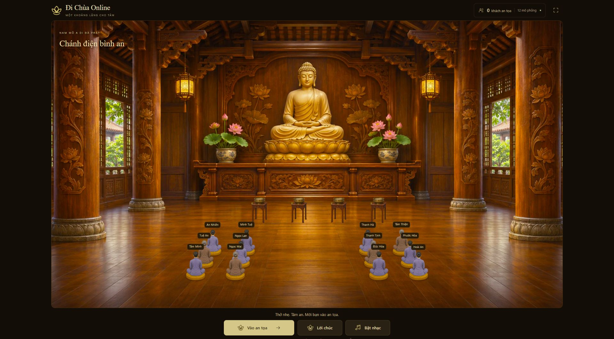
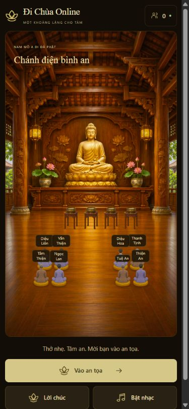

# Tên và số lượng nhân vật theo lượt mở trang

Bản cập nhật ngày 05/11/2026 bổ sung tên hiển thị và số lượng ngẫu nhiên cho
lớp nhân vật an tọa. Các tên là tên hư cấu, chọn từ 36 tên Việt/pháp danh như
An Nhiên, Minh Tâm, Diệu Liên; mỗi nhân vật trong cùng lượt có tên riêng.

- Mỗi lần tải trang chọn ngẫu nhiên mức hiện diện từ 8 đến 12. Số ngẫu nhiên
  có thể trùng giữa hai lượt; không phải lịch luân phiên cố định.
- Tên, y phục và ghế được tạo một lần trong lượt, không đổi theo nhịp hoạt ảnh,
  bản tin SSE hoặc khi người thật vào/rời phòng.
- Tên hiện phía trên nhân vật, không có hậu tố "bot". Màn hình nhỏ cho phép
  tên xuống dòng để hạn chế đè lên tên ở ghế bên cạnh.
- Khi có khách thật, bot giảm để nhường chỗ; vẫn giữ ghế đang làm lễ và sức
  chứa 24 khách thật. Nhân vật chỉ ngồi quay lên Phật.
- Thông tin nhân vật mô phỏng vẫn được ghi riêng trong giao diện và danh
  sách khách. Không gộp bot vào số khách thật hoặc tạo phiên người dùng giả.

## Kiểm tra

- Typecheck và build production đạt; 132/132 bài kiểm tra đạt.
- Kiểm đủ các mức 8–12, tên duy nhất và Unicode NFC, hồ sơ giữ ổn định khi
  thêm người hoặc đảo thứ tự bản tin, không trùng ghế cho mọi số khách 0–24.
- Ba lượt tải trang thực tế cho ra 12, 10 và 8 nhân vật với tên khác nhau;
  dữ liệu minh họa trong `visits.json`.
- Khách thử nghiệm vào phòng: 8 còn 7 nhân vật; tên và ghế của các nhân vật
  còn lại không đổi (`join-check.json`). Khách thử nghiệm đã rời phòng.
- Đã xem nhãn tên ở PC 1920×1080 và viewport 390×844; màn hình nhỏ không
  tràn ngang. Không có console warning/error trong phiên kiểm tra.

Ảnh dưới là hai lượt thử khác nhau, do đó số lượng và tên không giống nhau.

