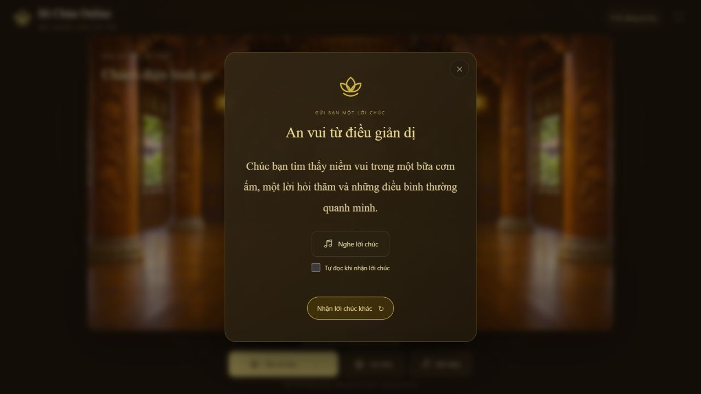
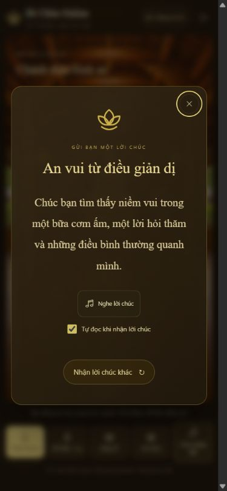
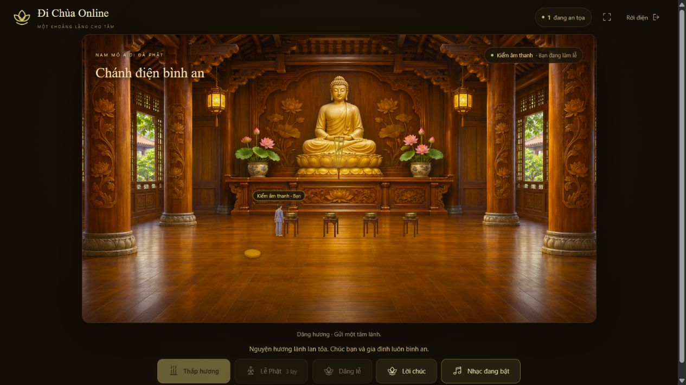

# Lời chúc, giọng đọc và âm thanh nghi lễ

Bản cập nhật cục bộ ngày 05/11/2026 cho yêu cầu rút còn 20 lời chúc,
đọc lời chúc thành tiếng và sửa dấu tiếng Việt bị rời chữ.

## Hành vi đã thực hiện

- Đúng 20 lời chúc, mỗi câu có tiêu đề và nội dung riêng. Xáo trộn theo lượt:
  đọc hết 20 câu mới lặp, không trùng câu cuối lượt với câu đầu lượt tiếp theo.
- Mở Lời chúc hoặc Nhận lời chúc khác sẽ tự đọc khi bật tùy chọn.
  Có Nghe lời chúc, Dừng đọc và Tự đọc khi nhận lời chúc.
- Đổi câu, đóng hộp thoại, Escape, ẩn tab hoặc đưa âm lượng về 0 sẽ hủy giọng đọc.
  Tải âm thanh cũ không được phát muộn hay ngắt câu mới. Tải lỗi có thông báo thử lại.
- Dâng hương, hoa sen, cánh sen, thỉnh chuông và lạy có âm điểm nhẹ cùng lời nguyện
  ngắn. Dâng lễ phát ở lúc trao lễ vật; lạy phát sau lạy thứ ba khi bắt đầu đứng lên.
  Chỉ hành động của chính người dùng phát tiếng trên thiết bị của họ.
- Nút Âm thanh và lời nguyện khi làm lễ cho phép tắt riêng phần này. Lời nguyện
  bằng chữ vẫn hiện ngắn dưới trạng thái. Không chen tiếng vào hộp thoại lời chúc
  hoặc giọng đọc đang chạy; không phát lại nghi lễ cũ sau khi quay về tab.
- Nhạc nền giảm còn 22% mức âm lượng đã chọn trong lúc đọc, rồi trở lại mức cũ.
  Âm lượng chung áp dụng cho nhạc, giọng đọc và âm điểm.
- Noto Serif được đóng gói cùng web, giữ định vị dấu tiếng Việt và các bảng mark/mkmk.
  Catalog dùng Unicode NFC; không dùng dấu hoặc phần tử rời để dựng chữ.

## Tài nguyên và cấu trúc

`src/data/blessingCatalog.ts` là nguồn nội dung duy nhất cho 20 lời chúc và 5 lời nguyện.
ID b01–b20 nối từng câu với MP3 tương ứng. Khi sửa câu, tạo lại âm thanh và chạy
kiểm tra đối chiếu nội dung để tránh lời đọc khác chữ trên màn hình.

Giọng đọc là **giọng tổng hợp Microsoft An, vi-VN**, được xuất sẵn thành MP3.
Thiết bị truy cập không cần cài giọng Windows, không phụ thuộc Web Speech API
và không gửi nội dung đến dịch vụ TTS. Tổng âm thanh mới khoảng 1,27 MB, tải theo nhu cầu;
font WOFF2 khoảng 83 KB. WAV và TTF gốc nằm ngoài thư mục public.

Hồ sơ nguồn, thông số và cách dựng lại:
[giọng đọc](../../artwork/audio-voice-v1/README.md),
[font và giấy phép](../../artwork/fonts-v1/README.md).

## Kết quả kiểm tra

- `npm run typecheck`: đạt.
- `npm test`: 128/128 bài đạt, không thất bại.
- `npm run build`: đạt; 70 module được đóng gói.
- Kiểm MP3: 25/25 file giải mã thành PCM, có tín hiệu, đúng SHA/nội dung,
  không clipping 16 bit; âm lượng, thời lượng và khoảng im lặng được ghi trong manifest.
- Trình duyệt, bản production cục bộ: nhận đủ 20 tiêu đề khác nhau trong một lượt;
  tự đọc, nghe lại, dừng, chuyển câu và Escape có trạng thái đúng. Tắt/bật âm nghi lễ được phản ánh trong giao diện.
- Thắp hương thực tế trong phòng: lời nguyện hiện tại đúng mốc dâng hương;
  kiểm tự động bao phủ mốc và chống phát lặp của cả 5 nghi lễ.
- Desktop và viewport 390×844, 360×740: chữ “điều” hiển thị dấu liền chữ,
  hộp lời chúc không tràn ngang; font tính toán là Chua Noto Serif. Không có console warning/error.

Đây là kiểm tích hợp, hình ảnh, tín hiệu và nội dung đầu vào. Chưa nghiệm thu
phát âm bằng người nghe hay thử trên Safari/iPhone/Android thật; không xem các
kết quả trên là cam kết mọi thiết bị đều giống nhau.

