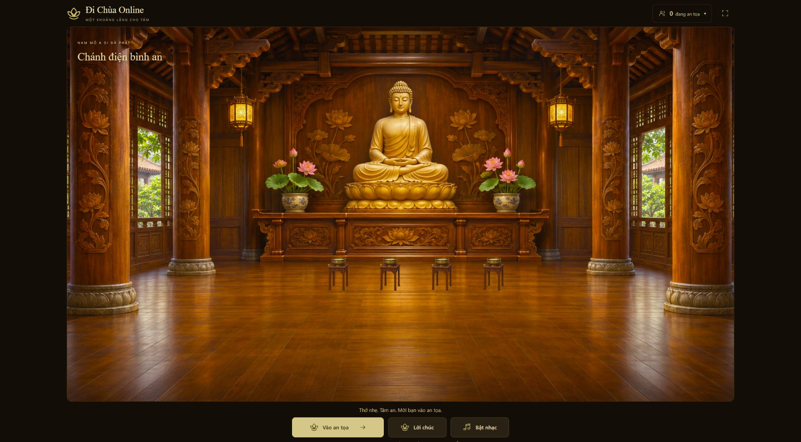

# Giao diện đầu trang và thanh thao tác

Bản chỉnh ngày 05/11/2026 giữ kích thước chánh điện PC của bản gốc, thu gọn
đầu trang và thanh thao tác, dùng nền nâu cùng màu vàng nhạt để phân cấp nút chính.
Không có gradient, vòng trang trí logo, slogan giữa đầu trang hoặc hiệu ứng nhấc nút.

`SanctuaryHeader` và `SanctuaryDock` tách riêng phần trình bày khỏi trạng thái phòng
và âm thanh trong App. Các quy tắc CSS cũ tương ứng được chuyển khỏi index.css
sang `src/styles/sanctuary-shell.css`; không giữ hai bộ quy tắc cạnh tranh nhau.

## Kích thước đã đối chiếu

PC dùng đúng công thức ban đầu: rộng tối đa 1.600 px, tỷ lệ 16:9, chừa 180 px
cho phần ngoài chánh điện. Đầu trang cao 64 px. Không dùng giới hạn 1.440 px
hoặc chừa 310 px như bản thiết kế đã bị thu nhỏ.

| Viewport kiểm tra | Khung chánh điện | Kết quả |
| --- | --- | --- |
| 1920 × 1080 | 1600 × 900 | Đúng kích thước cũ; không tràn ngang hoặc dọc ở trạng thái khách |
| 1366 × 768 | Khoảng 1045,33 × 588 | Đúng công thức cũ; không tràn ngang hoặc dọc ở trạng thái khách |
| Rộng 390 px | Tỷ lệ dọc 9:16 | Không tràn ngang; nút cao ít nhất 48 px |
| Rộng 320 px | Tỷ lệ dọc 9:16 | Không tràn ngang, kể cả khi thanh cuộn chiếm 15 px |

Ở màn hình nhỏ, nút vào điện chiếm một hàng; lời chúc và nhạc nằm ở hàng kế.
Sau khi an tọa, ba thao tác nghi lễ ở hàng đầu, lời chúc và nhạc ở hàng tiếp theo.
Giữ kích thước đích bấm và không giảm chữ để nhét cả năm nút vào một hàng.

## Kiểm tra

- Typecheck và build production đạt.
- 128/128 bài kiểm tra hiện có đạt, không thất bại.
- Thử trực tiếp mở biểu mẫu, vào điện, hiển thị thanh thao tác sau an tọa,
  mở dâng lễ, mở lời chúc có giọng đọc và rời điện thành công.
- Bản cuối không có console warning/error trong phiên kiểm tra.
- Viewport kiểm tra đã được trả về mặc định; người kiểm thử đã rời phòng.

Đây là kiểm bằng trình duyệt và viewport mô phỏng, chưa thay thế kiểm trên điện thoại thật.

